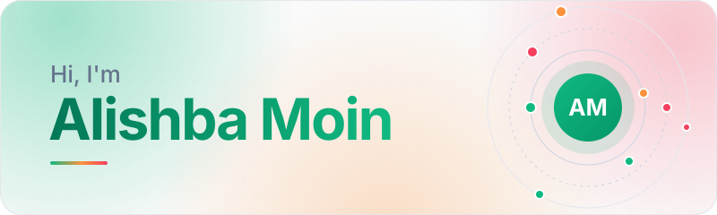

<!--
  Profile README for Alishba-Moin/Alishba-Moin
  Design system (mirrors the portfolio): #FAFAFA base, white cards, emerald primary,
  tangerine + rose as supporting accents. Light and dark header variants live in /assets.
  To edit: change text below. Header and divider are plain SVG files in /assets.
-->

<picture>
  <source media="(prefers-color-scheme: dark)" srcset="assets/header-dark.svg">
  
</picture>

  <strong>AI Engineer · Agentic AI Developer · Full-Stack Developer · Forward Deployed Engineer (FDE)</strong>

  I build autonomous AI agents, agentic systems, MCP integrations, and modern full-stack applications. 
  My work connects AI capabilities to real workflows through intelligent automation, multi-agent orchestration, and scalable web technologies.

  <a href="https://alishba-s-portfolio-sigma.vercel.app/">Portfolio</a> &nbsp;·&nbsp;
  <a href="https://www.linkedin.com/in/alishba-moin/">LinkedIn</a> &nbsp;·&nbsp;
  <a href="mailto:alishbamoin0025@gmail.com">Email</a>

<strong>01 — FOCUS</strong>

## What I Work On

**Agents that do real work.** I design agents that plan, call tools, and hand tasks to one another, using the OpenAI Agents SDK. I prefer structured, predictable pipelines over one long prompt, so the behavior is easy to reason about and debug.

**AI connected to the tools people already use.** Through MCP servers and scheduled workflows, I wire agents into channels like Gmail, WhatsApp, and LinkedIn, with a human approving the actions that matter.

**The full application around the model.** Next.js and TypeScript for the interface, FastAPI and Node.js for the API, MongoDB for data. An agent is only useful once it sits inside a product someone can actually use.

<strong>02 — STACK</strong>

## Technical Expertise

**AI & Agentic AI** 
`OpenAI Agents SDK` `Agentic AI` `Autonomous Agents` `Multi-Agent Systems` `Tool Calling` `Handoffs` `Guardrails` `Prompt Engineering` `Context Engineering` `RAG` `Vector Embeddings`

**Integrations & Automation** 
`Model Context Protocol (MCP)` `MCP Server Integrations` `AI Workflow Automation` `Human-in-the-Loop Systems`

**Frontend** 
`Next.js` `React.js` `TypeScript` `JavaScript` `Tailwind CSS` `HTML5` `CSS3`

**Backend & Databases** 
`Python` `FastAPI` `Node.js` `REST APIs` `MongoDB` `SQL` `JWT Authentication`

**Tools & Platforms** 
`Git` `GitHub` `Docker` `Vercel` `Sanity CMS` `Stripe` `Claude Code` `Cursor` `Gemini CLI`

<strong>03 — APPROACH</strong>

## Engineering Approach

- **Systems over demos.** I build things meant to keep running, not one-off prototypes.
- **Structured workflows.** Agents get clear roles, tools, and handoffs instead of open-ended instructions.
- **AI inside real applications.** The model is one component, next to a UI, an API, and a database.
- **Controlled automation.** Approval gates and guardrails sit in front of actions that have consequences.
- **Maintainable code.** Typed, modular, and reusable, so a project is easy to extend later.
- **Range across the stack.** I can own the agent, the API, and the interface in one project.

<strong>04 — NEXT</strong>

## Currently Exploring

- Advanced agent orchestration
- MCP ecosystems
- Production-ready AI systems
- Reliable autonomous workflows
- AI integration patterns

<strong>05 — CONTACT</strong>

## Let's Connect

Open to Forward Deployed Engineer, AI Engineer, and Agentic AI roles, and to freelance AI agent projects.

- **Portfolio** · [alishba-s-portfolio-sigma.vercel.app](https://alishba-s-portfolio-sigma.vercel.app/)
- **LinkedIn** · [linkedin.com/in/alishba-moin](https://www.linkedin.com/in/alishba-moin/)
- **Email** · [alishbamoin0025@gmail.com](mailto:alishbamoin797@gmail.com)
- **GitHub** · [github.com/Alishba-Moin](https://github.com/Alishba-Moin)
